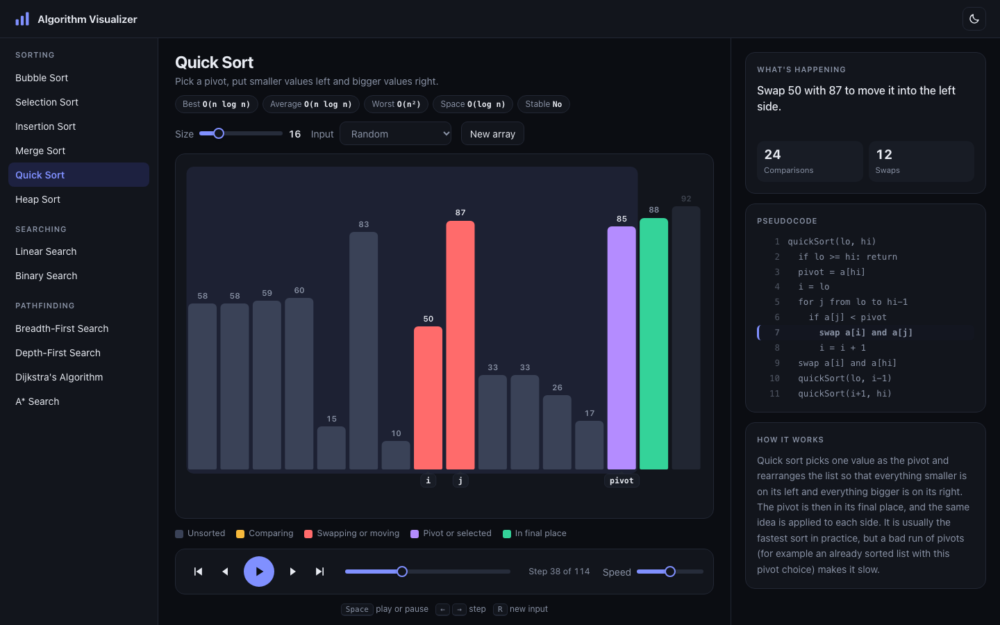
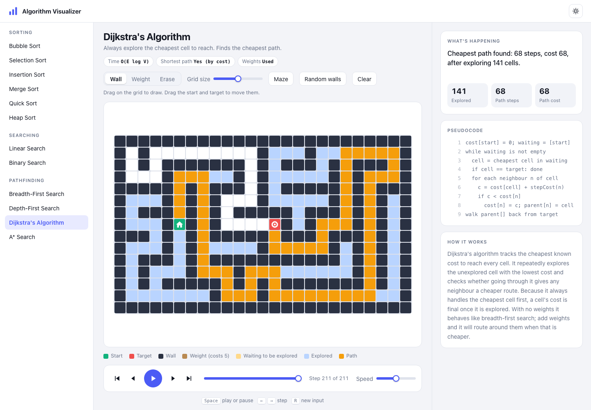

# Algorithm Visualizer

Watch algorithms work one step at a time, with a plain-language explanation of every step.



Algorithms are easy to read about and hard to picture. This page plays each one as an animation you fully control: pause it, step backwards, drag the timeline, and read what is happening and why at every step while the matching line of pseudocode lights up.

## Algorithms

| Sorting | Searching | Pathfinding |
|---|---|---|
| Bubble sort | Linear search | Breadth-first search |
| Selection sort | Binary search | Depth-first search |
| Insertion sort | | Dijkstra's algorithm |
| Merge sort | | A* search |
| Quick sort | | |
| Heap sort | | |

## Features

- **Full step control:** play, pause, step forward and back, jump to either end, drag the timeline, five speeds
- **Narration:** one sentence per step explaining what the algorithm just did and why
- **Pseudocode:** the line being executed is highlighted as you step
- **Consistent colours:** amber for comparing, red for swapping, violet for the pivot or selection, green for final, with labelled pointers (`i`, `j`, `lo`, `mid`, `pivot`) under the bars
- **Real movement:** bars slide past each other when they swap, so you can follow one value across the list
- **Live counters:** comparisons and swaps, or cells explored and path cost, plus best, average and worst-case complexity
- **Sorting inputs:** random, nearly sorted, reversed or few unique values, from 5 to 64 items; all six sorts share one array so you can compare them on the same input
- **Pathfinding grid:** draw walls and weights, drag the start and target, generate a maze or random walls, and resize the grid
- **Light and dark themes**, and a layout that adapts to smaller screens



## Run it

There is nothing to install or build. Clone the repo and open `index.html` in a browser:

```bash
git clone https://github.com/praveenindian/algo-visualizer.git
cd algo-visualizer
open index.html        # macOS; on Windows or Linux, double-click the file
```

## Keyboard shortcuts

| Key | Action |
|---|---|
| `Space` | Play or pause |
| `←` `→` | Step back or forward |
| `R` | New array, or a new maze on the grid |

## How it works

It is plain HTML, CSS and JavaScript with no dependencies.

Each algorithm runs once, up front, and records a list of steps. A step holds everything needed to draw that moment: the order of the items, what is highlighted, where the pointers are, which pseudocode line is running and the sentence explaining it. The player only moves through that list, which is what makes stepping backwards and scrubbing possible.

| File | Purpose |
|---|---|
| `js/sorting.js`, `js/searching.js`, `js/pathfinding.js` | The algorithms and their recorded steps |
| `js/arrayView.js` | Draws lists as bars |
| `js/gridView.js` | Draws and edits the pathfinding grid |
| `js/player.js` | Play, pause, step and seek |
| `js/app.js` | Ties the page together |

To add an algorithm, add an object with `id`, `name`, `kind`, `code`, `about`, `info` and a `run` function that returns steps to the list in the matching file. It then appears in the sidebar automatically.

## License

[MIT](LICENSE)
